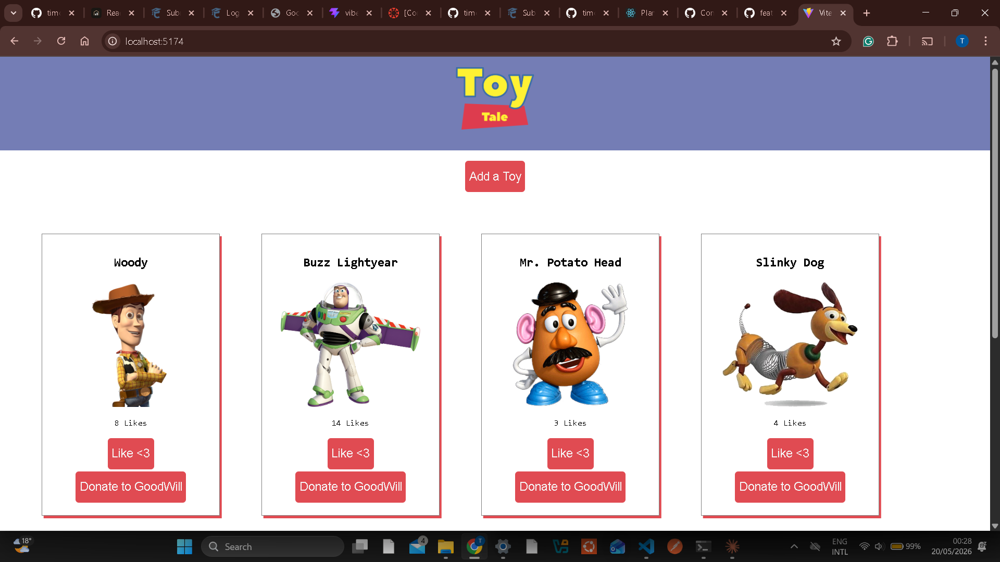

# 🧸 Toy Tales

A React CRUD application for managing a toy collection.

## Screenshot



## Features

- View all toys on page load
- Add a new toy via the form (persisted to backend)
- Like a toy to increase its like count
- Donate (delete) a toy from the collection

## Setup

1. Clone the repository
2. Install dependencies:
```bash